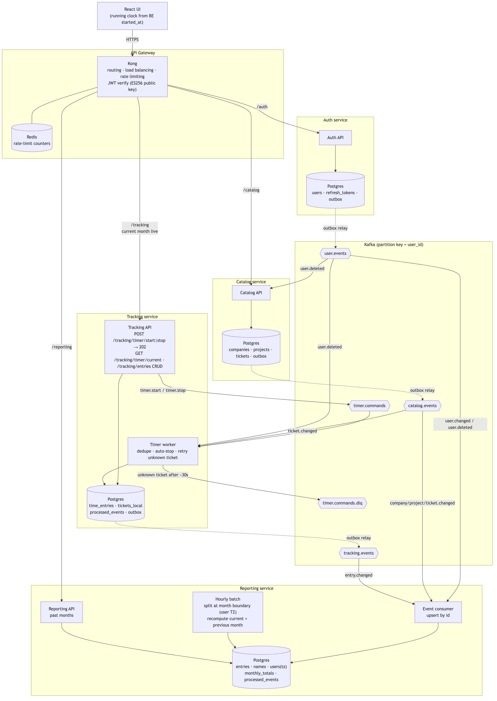
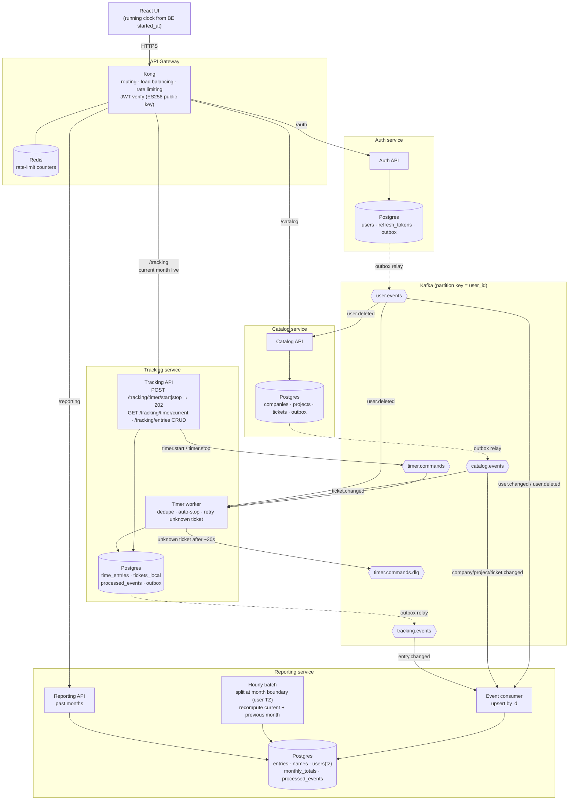

# System design

<!-- Rendered from the Mermaid source below. Regenerate after edits:
     npx @mermaid-js/mermaid-cli -i <source>.mmd -o assets/system-design.png -w 1800 -s 2 -b white -->

## Key flows

1. **Start timer:** UI → Kong → `POST /tracking/timer/start` (with a UUID the UI generates) → `202`. The command goes to `timer.commands`. The worker dedupes it, stops any running entry, and inserts the new one together with an outbox row in a single transaction. `entry.changed` is then published, and the UI polls `GET /tracking/timer/current`.
2. **Edit entry:** UI → Kong → Tracking REST. The DB row and outbox row are written in one transaction, then `entry.changed` is published to Reporting.
3. **Dashboard:** the current month is read live from Tracking; past months come from Reporting's `monthly_totals`.
